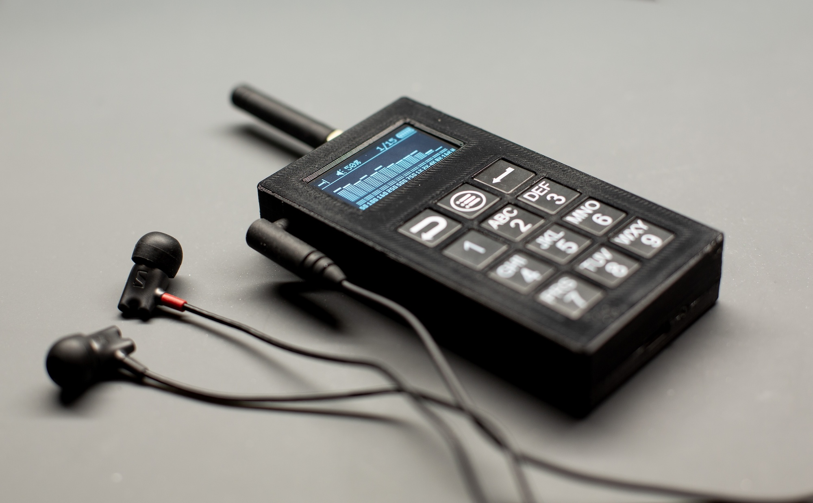
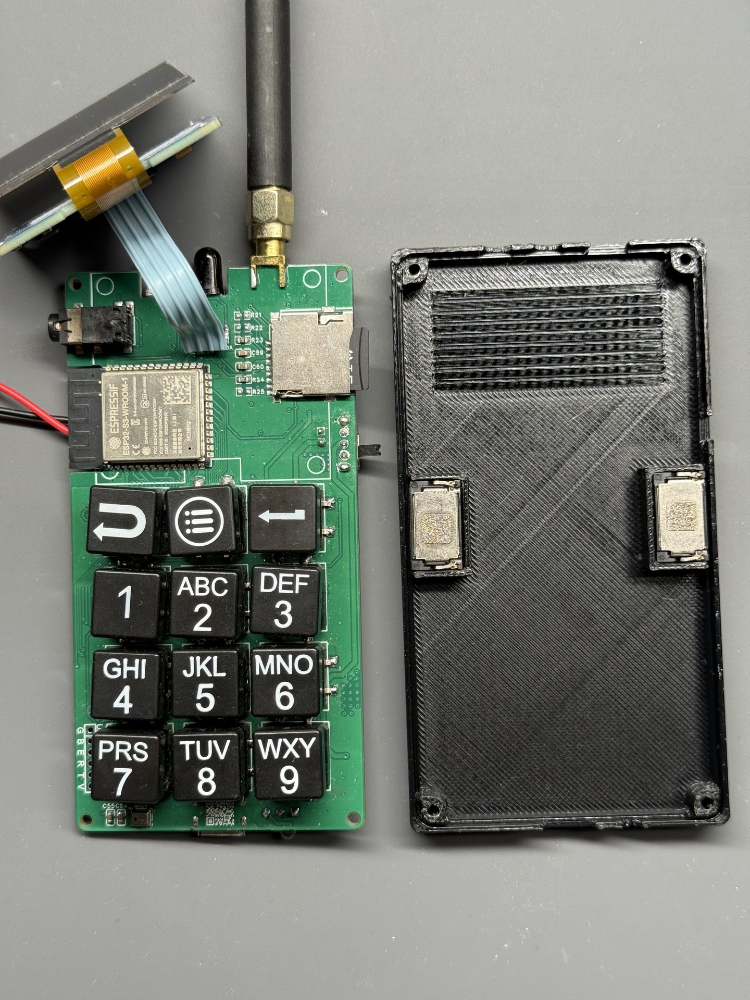
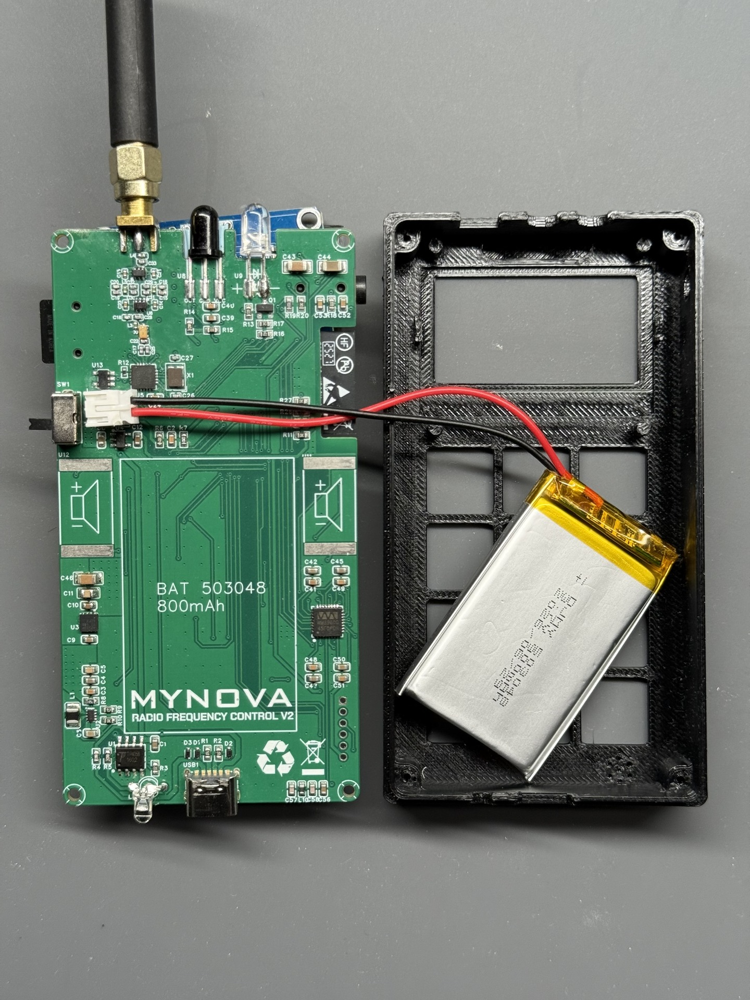
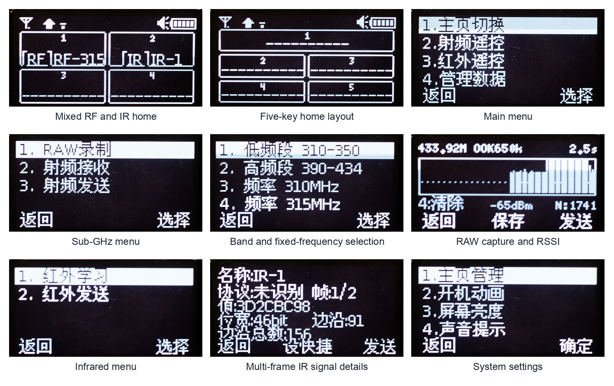
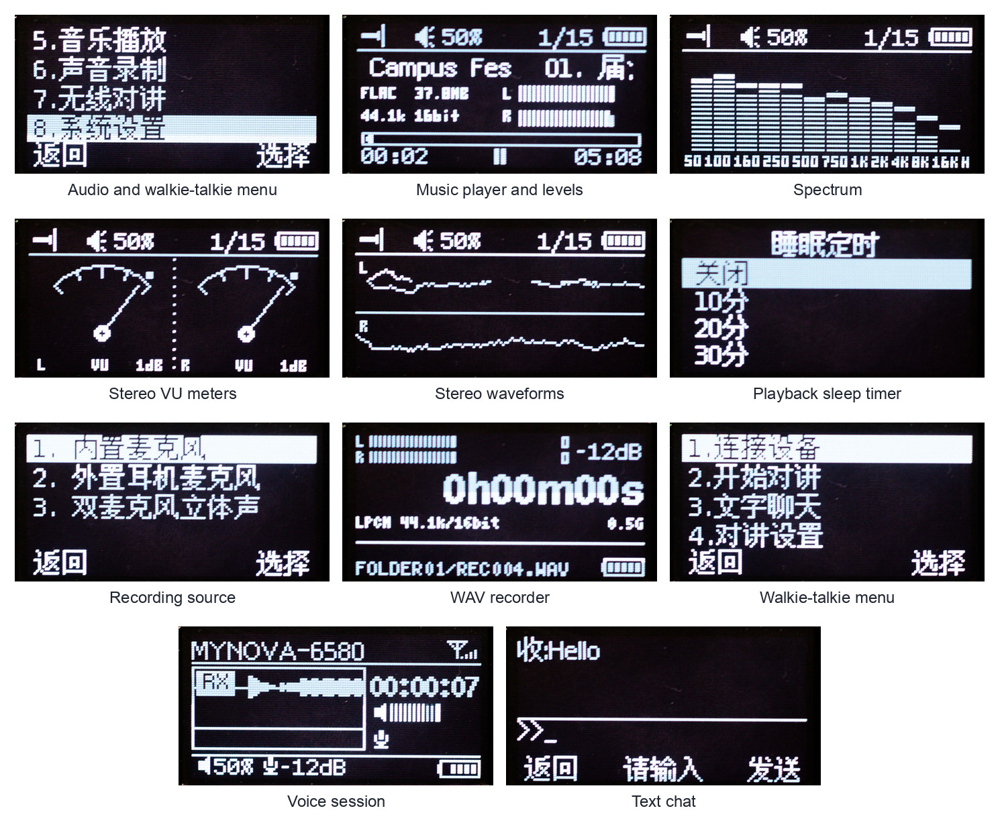
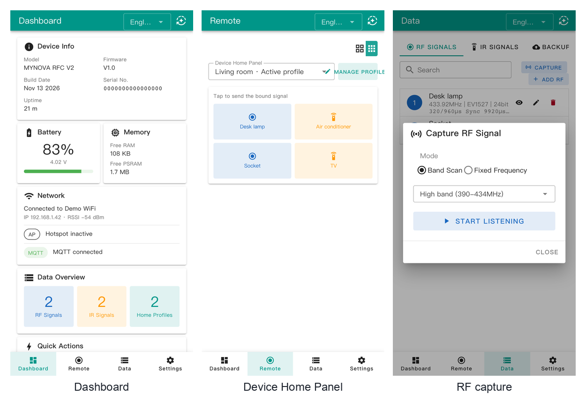
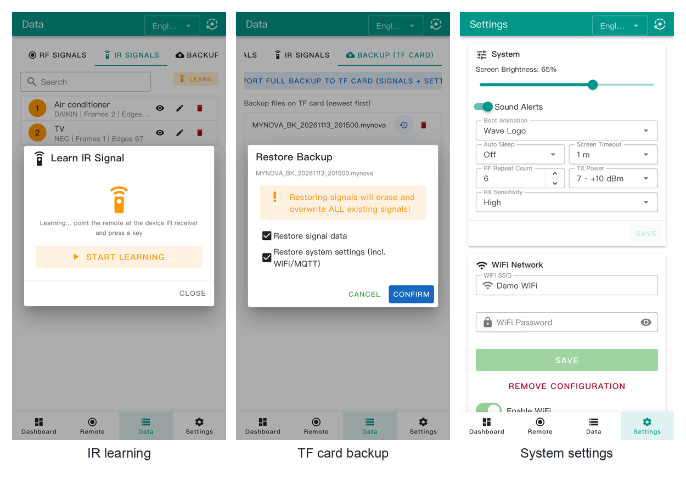

# MYNOVA RFC V2

[简体中文](README_CHS.md)

MYNOVA RFC V2 is an open-source ESP32-S3 handheld with dual-band Sub-GHz radio, infrared remote control, microSD audio, ESP-NOW intercom and Home Assistant integration. It has a 128×64 OLED, 12 physical keys and a bilingual browser interface.

## What's new in V2

| Feature | V2 changes |
| --- | --- |
| Dual-band Sub-GHz | The CC1101 and onboard RF switch support scanning preset frequencies in the 310–350 MHz and 390–434 MHz bands or listening on a fixed frequency. V2 adds RAW pulse recording, an RSSI plot and threshold, eight transmit power levels and adjustable receive sensitivity. |
| Infrared | 38 kHz transmission, single- and multi-frame learning, frame details and 100 dedicated IR slots. |
| Home profiles | Up to eight profiles with one to nine keys each. Each profile can mix RF and IR shortcuts. Switch the active device profile on the device, from the Web UI or through Home Assistant. |
| Audio and microSD | The WM8960 handles speaker and headphone output, microphone input and UI tones. Play MP3, WAV, FLAC, AAC, Opus (including Ogg Opus) and MOD files, record WAV audio, manage files and store backups on the card. |
| Wireless intercom | Pair two V2 units via ESP-NOW for push-to-talk, full-duplex voice, text chat and quick phrases. |
| Web and smart home | The browser interface adds a dashboard, RF capture, IR learning, profile editing, microSD backup and restore, and firmware uploads. Home Assistant adds IR buttons, an active-home selector and a battery entity. |
| Firmware and display | V2 moves to ESP32-S3, runs the OLED UI in a dedicated FreeRTOS task and adds selectable boot animations. |

## V2 hardware



| PCB front and front shell | PCB back and rear shell |
| --- | --- |
|  |  |

V2 uses an ESP32-S3-WROOM-1-N8R2, a CC1101, an IR receiver and transmitter, a WM8960 audio codec and a microSD slot. Editable enclosure models are available for the [top shell](3DModels/SHELL_TOP.step) and [bottom shell](3DModels/SHELL_BOTTOM.step).

## OLED screens




## Device menu

**[New]** and **[Updated]** mark changes introduced in V2. The device OLED uses Chinese menu labels.

```text
Home
└── Menu
    ├── 1. Switch home [New]
    ├── 2. Sub-GHz remote [Updated]
    │   ├── RAW record [New] → frequency / modulation / RSSI threshold
    │   ├── RF receive [Updated] → low band / high band / 10 fixed frequencies
    │   └── RF send → saved signals / details / send / bind shortcut
    ├── 3. Infrared remote [New]
    │   ├── IR learn → frame and pulse details / save
    │   └── IR send → saved signals / details / send / bind shortcut
    ├── 4. Manage data [Updated]
    │   ├── RF data → view / edit / delete
    │   ├── IR data [New] → view / rename / delete
    │   └── microSD data [New] → file operations / settings / storage info
    ├── 5. Music [New] → card browser / player / sleep timer
    ├── 6. Audio recording [New] → built-in mic / headset mic / stereo dual mic
    ├── 7. Wireless intercom [New]
    │   ├── Connect device
    │   ├── Start voice session
    │   ├── Text chat
    │   └── Intercom settings → device name / channel / PTT or FULL
    ├── 8. System settings
    │   ├── 1. Manage homes [New] → create / activate / edit keys / rename / delete
    │   ├── 2. Boot animation [New]
    │   ├── 3. Display brightness
    │   ├── 4. Sound prompts [Updated]
    │   ├── 5. Power saving
    │   ├── 6. Repeat transmission
    │   ├── 7. Transmit power [New]
    │   ├── 8. Receive sensitivity [New]
    │   ├── 9. AP mode
    │   ├── 10. Wi-Fi mode
    │   ├── 11. Backup [New] → export / restore all / signals only / settings only
    │   ├── 12. Factory reset
    │   ├── 13. System version
    │   └── 14. Firmware update
    └── 9. Games
        ├── Flappy Bird
        ├── Snake
        ├── Tetris
        ├── Arkanoid
        ├── Tank Battle
        ├── Racing
        └── Shooter
```

## V2 controls

From the home screen, press **Menu**, the top-center key. In most lists, **2 / 8** move up and down, **Enter** opens the selected item and **Back** exits. The labels along the bottom of the OLED show what the three top keys do on the current screen.

### Home profiles and shortcuts

Open **System settings → Manage homes**, choose **New home**, select a one- to nine-key layout with **2 / 8** and **Enter**, then name the profile. Select an existing profile to activate it, edit its keys, rename it or delete it. Each key can bind an RF or IR slot, and bindings can be cleared. In **Switch home**, use **2 / 8** to choose a profile and **Enter** to activate it. On the home screen, press the corresponding number to send. In a single-key layout, any number key triggers the same shortcut.

### Dual-band RF and RAW recording

**Sub-GHz remote → RF receive** scans the preset frequencies in the 310–350 MHz or 390–434 MHz band, or listens on a fixed frequency. The CC1101 uses an external RF switch. Under **System settings**, choose from eight transmit power levels and three receive sensitivity levels. Use **2 / 6** to increase, **4 / 8** to decrease, **Enter / 5** to save or **Back** to cancel.

**Sub-GHz remote → RAW record** preserves pulse timing. Use **2 / 8** to select frequency, modulation or RSSI threshold, **4 / 6** to change the value, and **Enter / 5** to start. Watch the RSSI plot and press **Back** or **Enter** to stop recording. Then **Enter / 5** transmits, **Menu / 6** saves to an RF slot, and **4** clears the recording. Saving requires a microSD card. Pulse data goes into a `.sub` file under `/MYNOVA_RAW/`, and the slot holds the signal metadata.

### Infrared learning and sending

Open **Infrared remote → IR learn** and point your remote at the device's IR receiver. After learning, use **1 / 8** to browse frames, **Menu** to view details or **Enter** to select a slot and save. In **IR send**, select a saved signal, then press **Enter** to send or **Menu** to bind it to a home shortcut. The firmware preserves pulses and gaps between frames for multi-frame remotes, including air conditioners.

### Music and audio recording

- **Music**. Use **2 / 8** to select a file, **4 / 6** to page through the microSD browser and **Enter / 5** to open. In the player, **Enter / 5** plays or pauses, **4 / 6** skips tracks, **2 / 8** adjusts volume, **1** cycles through sequence, repeat all, repeat one and shuffle, **3** cycles through playback info, spectrum, VU meters and waveforms, and **Menu** opens the sleep timer. Use **2 / 8** to select the duration and **Enter** to apply it.
- **Audio recording**. Choose the built-in mic, a headset mic or both mics for stereo. **Enter / 5** starts or stops recording, **2 / 8** adjusts gain, and **Back** stops recording and exits. The recorder writes 44.1 kHz, 16-bit PCM WAV files to `/Record/FOLDER01/` on the card. Either microphone by itself records mono.

### ESP-NOW voice and text

Open **Wireless intercom** on both units and set them to the same channel in **Intercom settings**. Use **2 / 8** to select a field, **4 / 6** to change its value and **Enter** to save. On one device, select the other under **Connect device** and press **Enter**. Press **Enter** on the other device to accept. Once paired, open **Start voice session** or **Text chat**.

- **Voice**. In PTT mode, hold **5** to speak and release it to stop transmitting. **Enter** also toggles transmission in this mode. FULL mode supports full-duplex voice. **1** toggles mute, **2 / 8** adjusts volume, **4 / 6** adjusts mic gain, and **7 / 9** sends quick phrases.
- **Text**. Press **Menu** or **5** to open the input, enter text with the number keys, delete characters with **Menu** and send with **Enter**. When browsing, **2 / 8** scrolls by line, **4 / 6** by page, and **7 / 9** sends quick phrases.

### microSD files and backups

- **Manage data → microSD data**. **2 / 8** selects an item, **Enter / 5** opens it, **Menu** opens file operations, **1** marks the selected item and **3** clears marks. You can copy, move, rename, delete, view properties, create folders and check storage capacity.
- **System settings → Backup**. Use **2 / 8** to select an item and **Enter / 5** to export a backup or open an existing one. The `.mynova` archives in `/backup/` contain RF (including RAW), IR, home profiles and system settings. Restore all data, signals only or settings only. Restore replaces the selected categories, and settings backups may contain Wi-Fi and MQTT credentials.

### Boot animation

Open **System settings → Boot animation**. Use **2 / 8** to select Wave Logo, Radar, Meteor, Typewriter, Matrix Rain or Off. Apply with **Enter / 5**.

## Mobile Web UI

Connect your phone and device to the same LAN, or connect the phone to the device's Wi-Fi access point. Open the IP address shown under **Wi-Fi mode** or **AP mode** in your phone's browser.

- **Dashboard** shows firmware, network, battery, memory and signal counts.
- **Remote** sends saved RF and IR signals and lets you edit or switch home profiles.
- **Data** offers RF capture, IR learning, signal details, and microSD backup and restore.
- **Settings** manages system options, Wi-Fi, AP, MQTT and firmware uploads.

These screenshots show the V2 frontend at a mobile viewport with sample data.




## Home Assistant

Enable the MQTT integration in Home Assistant and use **Settings → Home Assistant** in the Web UI to connect the device to the same MQTT broker. MQTT discovery groups the following entities under one RFC device.

- **RF and IR buttons**. Each saved signal has a button you can call with `button.press`. The entity list updates when you add, rename or delete signals. MQTT uses slots 1–100 for RF and 101–200 for IR.
- **Active home**. Select the active device profile. Profile changes from the physical controls and Web UI also update this entity.
- **Battery**. Shows device battery level. MQTT entities become unavailable when the device goes offline.

The Home Assistant device page links to the RFC Web UI. [Home Assistant MQTT documentation](https://www.home-assistant.io/integrations/mqtt/)

## V1 features carried forward

V2 retains 100 RF slots, fixed-code learning and sending, manual signal editing, T9 naming, home-screen shortcuts, Wi-Fi/AP control, MQTT discovery, battery monitoring, brightness and power-saving settings, and all seven games. See the [V1 project](https://github.com/Tomosawa/MYNOVA-RFC) for its original controls and demos.

## Development Environment & Dependencies

| Component | Verified Version |
|---|---|
| Arduino IDE | 2.3.6+ |
| esp32 Arduino core (Boards Manager) | 3.3.5 |
| U8g2 | 2.34.22 |
| IRremoteESP8266 | 2.9.0 |
| ArduinoJson | 7.0.3 |
| ESP Async WebServer | 3.9.2 |
| AsyncTCP | 3.4.9 |
| PubSubClient | 2.8 |
| ESP8266Audio | 2.4.1 |
| arduinoFFT | 2.0.4 |

Use the official [IRremoteESP8266 2.9.0 release](https://github.com/crankyoldgit/IRremoteESP8266/releases/tag/v2.9.0) for ESP32 core 3.x timer API support; the unmodified 2.8.6 release does not compile with core 3.3.5.

In Arduino IDE, set the following options under **Tools**.

* Board: **ESP32S3 Dev Module**
* PSRAM: **QSPI PSRAM** (ESP32-S3-WROOM-1-N8R2 with 8 MB flash and 2 MB Quad SPI PSRAM). [Espressif module datasheet](https://www.espressif.com/sites/default/files/documentation/esp32-s3-wroom-1_wroom-1u_datasheet_en.pdf)
* Flash Size: **8MB**, Flash Mode: **QIO**
* Partition Scheme: **Custom** (uses `partitions.csv` in the sketch folder)

## Quick start

1. Open [MYNOVA_RFC_V2.ino](MYNOVA_RFC_V2/MYNOVA_RFC_V2.ino) in Arduino IDE, install the dependencies above, select the board and partition settings, then compile and upload.
2. For the Web UI, run `npm ci` and `npm run build` in `RFCWeb_V2`. Pack and flash the contents of `dist/` to LittleFS at offset `0x610000` with size `0x1D0000`. See [partitions.csv](MYNOVA_RFC_V2/partitions.csv) and [ESP32-LittleFS-Flash](https://github.com/Tomosawa/ESP32-LittleFS-Flash).
3. On a device already running the V2 firmware and Web UI, open **Settings → Maintenance** and upload the compiled application `.ino.bin` for OTA.

The application partition is 3 MiB. Use the application binary for Web OTA. A factory image flashed at `0x0000` requires a merged image prepared for V2, including LittleFS if the Web UI is bundled.

### Firmware downloads and updates

Download `MYNOVA_RFC_V2-<version>-ESP32S3-N8R2-full.bin` from Releases. This **8 MiB factory image** includes the bootloader, partition table, OTA initialization data, application and Web UI. Select **ESP32-S3** in your ESP flashing tool and flash the single file at **`0x000000`**. Example using esptool 5.x (replace the port and filename):

```bash
python -m esptool --chip esp32s3 --port COM3 --baud 460800 write-flash 0x000000 MYNOVA_RFC_V2-v1.0.0-ESP32S3-N8R2-full.bin
```

Flashing the factory image replaces existing settings and saved data; back up first. Use this file for serial flashing, not Web OTA.

Each Release also includes `MYNOVA_RFC_V2-<version>-ESP32S3-N8R2-ota.bin`, the application binary without merging or padding. On a device running V2 with the same partition layout, upload this file under **Settings → Maintenance** in the Web UI. It updates only the application and does not contain the bootloader, partition table or LittleFS, so Web assets are not updated by OTA. Flash the factory image when you also need to update the bundled Web assets.

Both bin files have individual `.sha256` checksums.

## Repository layout

```text
MYNOVA-RFC-V2/
├── MYNOVA_RFC_V2/  Firmware, Arduino partition table, tests and verification notes
│   └── src/       Bsp, Drivers, Services, Proto, GUI, Lib, Pages, Util
├── RFCWeb_V2/     Vue 3 + Vuetify + Vite Web UI
├── 3DModels/      V2 enclosure STEP files
└── Images/v2/     V2 hardware photos, OLED photos and Web screenshots
```

The UIKernel runs key dispatch, page navigation and OLED rendering in one FreeRTOS task on Core 1. Audio, Wi-Fi and OTA use separate tasks on Core 0. See [TaskConfig.h](MYNOVA_RFC_V2/src/Util/TaskConfig.h) for task assignments. Pages, widgets and large temporary buffers prefer PSRAM. DMA buffers, task stacks and interrupt data use internal RAM.

## License

This project is licensed under the **GNU General Public License v3.0**. See the [LICENSE](LICENSE) file for details.

## Acknowledgements
- [rc-switch](https://github.com/sui77/rc-switch) — early timing references
- [IRremoteESP8266](https://github.com/crankyoldgit/IRremoteESP8266) — IR capture & protocol decoding
- [Flipper Zero](https://github.com/flipperdevices/flipperzero-firmware) — CC1101 OOK AGC register presets
