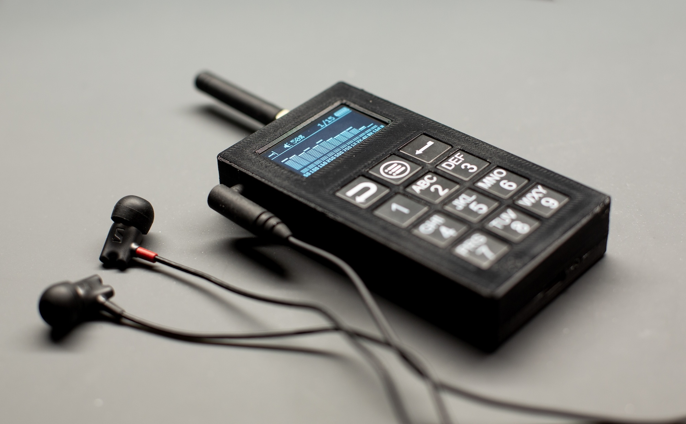
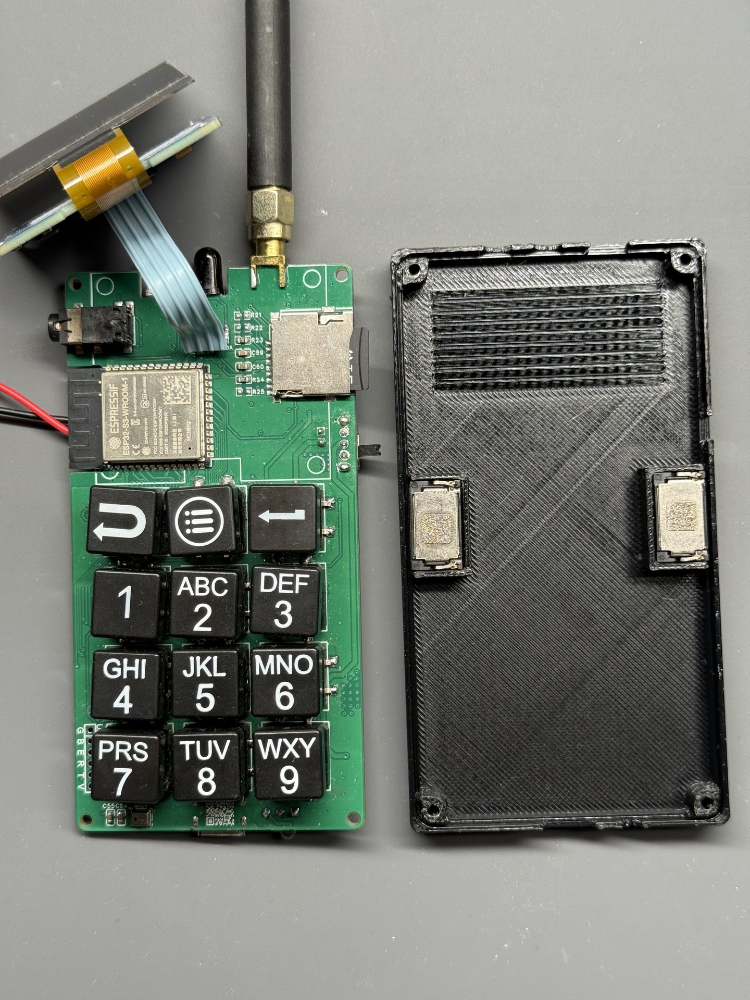
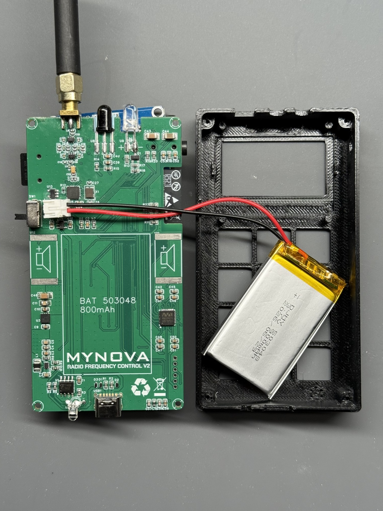
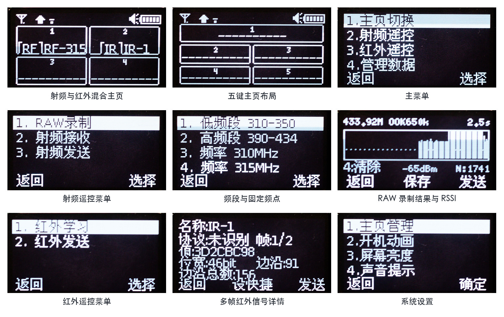
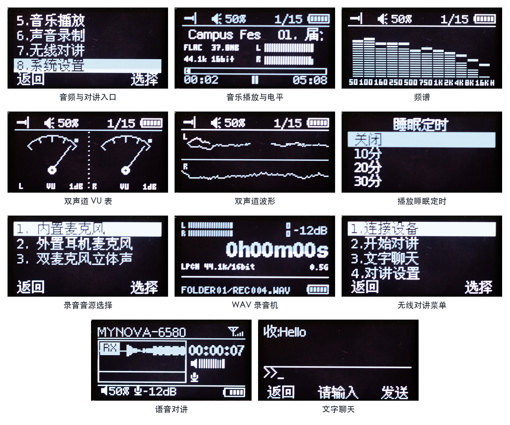
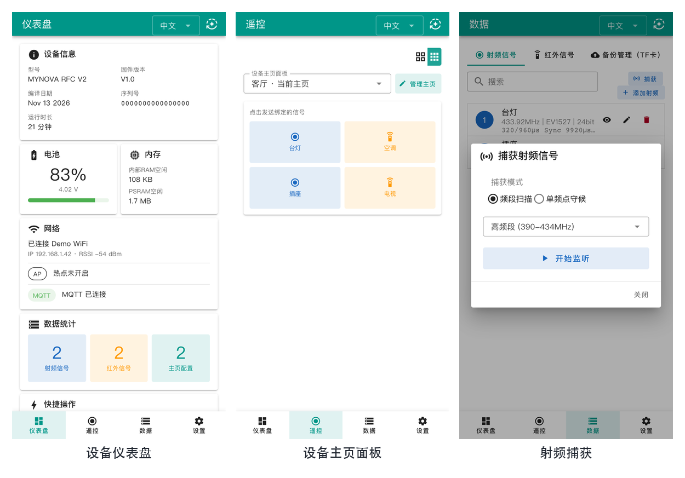
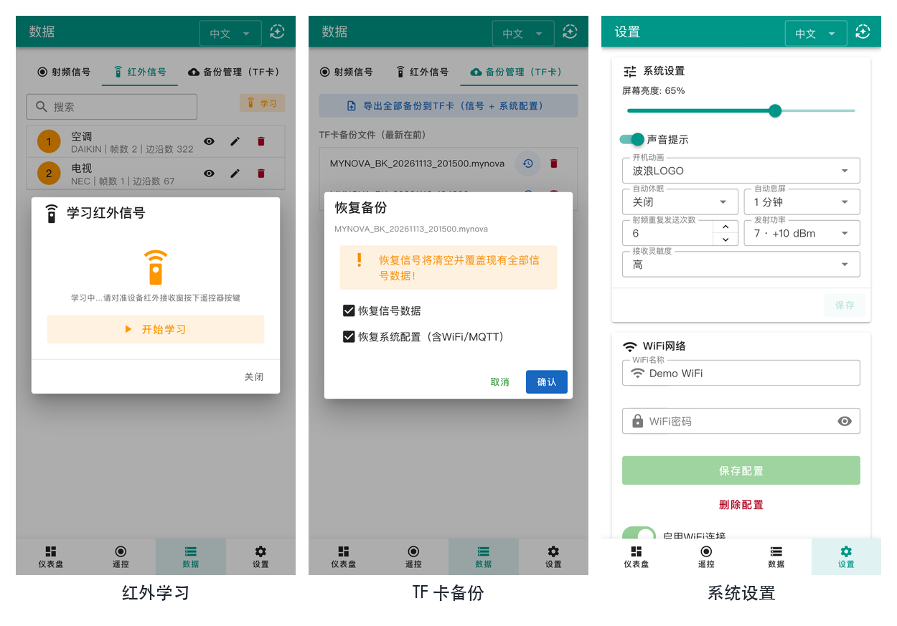

# MYNOVA RFC V2 · 射频遥控大师

[English](README.md)

MYNOVA RFC V2 是基于 ESP32-S3 的开源手持设备，集成双频段 Sub-GHz 射频、红外遥控、TF 卡音频、ESP-NOW 无线对讲和 Home Assistant。设备使用 128×64 OLED 和 12 个实体按键，配有支持中英文的 Web 管理台。

## V2 新增与升级

| 功能 | V2 更新 |
| --- | --- |
| 双频段射频 | CC1101 配合板载射频开关，支持 310–350 MHz 和 390–434 MHz 两组预设频点扫描或定频接收。增加 RAW 脉冲录制、RSSI 曲线与门限、8 档发射功率和接收灵敏度设置。 |
| 红外遥控 | 新增 38 kHz 红外收发、单帧与多帧学习、帧详情和 100 个独立红外槽位。 |
| 多主页 | 最多 8 套主页，每套 1–9 键，射频与红外可混合绑定。设备、Web 和 Home Assistant 可切换设备当前主页。 |
| 音频与 TF 卡 | WM8960 提供扬声器与耳机输出、麦克风输入和提示音。支持 TF 卡播放 MP3、WAV、FLAC、AAC、Opus（含 Ogg Opus）与 MOD，以及 WAV 录音、文件管理和备份。 |
| 无线对讲 | 两台 V2 可通过 ESP-NOW 配对，支持 PTT、全双工语音、文字聊天和快捷短语。 |
| Web 与智能家居 | V2 网页新增仪表盘、射频捕获、红外学习、主页编辑、TF 卡备份恢复及浏览器上传固件。Home Assistant 新增红外按钮、当前主页和电量实体。 |
| 固件与界面 | ESP32-S3 平台，OLED 界面由独立的 FreeRTOS 任务处理。新增可选开机动画。 |

## V2 实机与硬件



| PCB 正面与前壳 | PCB 背面与后壳 |
| --- | --- |
|  |  |

V2 使用 ESP32-S3-WROOM-1-N8R2、CC1101、红外收发器件、WM8960 编解码器和 TF 卡座。外壳提供可编辑的 [上壳 STEP](3DModels/SHELL_TOP.step) 和 [下壳 STEP](3DModels/SHELL_BOTTOM.step)。

## OLED 实机界面




## 设备菜单

标有 **[新增]** 或 **[增强]** 的项目对应 V2 的变化。

```text
主页
└── 菜单
    ├── 1. 主页切换 [新增]
    ├── 2. 射频遥控 [增强]
    │   ├── RAW录制 [新增] → 频率 / 调制 / RSSI 门限
    │   ├── 射频接收 [增强] → 低频段 / 高频段 / 10 个固定频点
    │   └── 射频发送 → 已存信号 / 详情 / 发送 / 设快捷
    ├── 3. 红外遥控 [新增]
    │   ├── 红外学习 → 帧与脉冲详情 / 保存
    │   └── 红外发送 → 已存信号 / 详情 / 发送 / 设快捷
    ├── 4. 管理数据 [增强]
    │   ├── 射频数据 → 查看 / 编辑 / 删除
    │   ├── 红外数据 [新增] → 查看 / 重命名 / 删除
    │   └── TF卡数据 [新增] → 文件操作 / 设置 / 存储信息
    ├── 5. 音乐播放 [新增] → TF 卡浏览 / 播放器 / 睡眠定时
    ├── 6. 声音录制 [新增] → 内置麦克风 / 外置耳机麦克风 / 双麦克风立体声
    ├── 7. 无线对讲 [新增]
    │   ├── 连接设备
    │   ├── 开始对讲
    │   ├── 文字聊天
    │   └── 对讲设置 → 设备名称 / 信道 / PTT 或 FULL
    ├── 8. 系统设置
    │   ├── 1. 主页管理 [新增] → 新建 / 设为当前 / 编辑按键 / 重命名 / 删除
    │   ├── 2. 开机动画 [新增]
    │   ├── 3. 屏幕亮度
    │   ├── 4. 声音提示 [增强]
    │   ├── 5. 节能设置
    │   ├── 6. 重复发送
    │   ├── 7. 发射功率 [新增]
    │   ├── 8. 接收灵敏度 [新增]
    │   ├── 9. AP模式
    │   ├── 10. WIFI模式
    │   ├── 11. 备份管理 [新增] → 导出 / 恢复全部 / 仅恢复信号 / 仅恢复配置
    │   ├── 12. 恢复出厂
    │   ├── 13. 系统版本
    │   └── 14. 固件更新
    └── 9. 休闲游戏
        ├── Flappy Bird
        ├── 贪吃蛇
        ├── 俄罗斯方块
        ├── 打砖块
        ├── 坦克大战
        ├── 极速赛车
        └── 雷霆战机
```

## V2 新功能与按键

在主页按上排中间的 **菜单** 键进入主菜单。一般用 **2 / 8** 上下移动、**确定** 进入、**返回** 退出。上排三个键的当前作用以 OLED 底部提示为准。

### 多主页与快捷键

进入 **系统设置 → 主页管理**，选择 **新建主页**，用 **2 / 8** 选 1–9 键布局并按 **确定**，再为主页命名。选中已建主页后可设为当前、编辑按键、重命名或删除。每个键位可绑定射频或红外槽位，也可清除绑定。主菜单的 **主页切换** 用 **2 / 8** 选主页，按 **确定** 启用。回到主页后按相应数字键发送，单键布局可用任一数字键触发同一个快捷项。

### 双频段射频与 RAW 录制

**射频遥控 → 射频接收** 可选 310–350 MHz 或 390–434 MHz 预设频点扫描，也可固定在单一频点。V2 使用 CC1101 和外部射频开关，在 **系统设置** 中可选择 8 档发射功率和 3 档接收灵敏度。按 **2 / 6** 升档、**4 / 8** 降档、**确定 / 5** 保存，或按 **返回** 取消。

**射频遥控 → RAW 录制** 用于保留原始脉冲时序。用 **2 / 8** 选择频率、调制或 RSSI 门限，用 **4 / 6** 调值，再按 **确定 / 5** 开始。录制时可查看 RSSI 曲线，按 **返回** 或 **确定** 停止。录制结束后按 **确定 / 5** 发送，按 **菜单 / 6** 保存到射频槽位，按 **4** 清除当前录制。保存需要 TF 卡，脉冲数据以 `.sub` 文件存放在 `/MYNOVA_RAW/`，槽位保留信号信息。

### 红外学习与发送

进入 **红外遥控 → 红外学习** 后对准设备的红外接收窗操作遥控器。学习完成后，用 **1 / 8** 查看上一帧或下一帧，按 **菜单** 看详情，按 **确定** 选择槽位并保存。进入 **红外发送** 选择信号后，按 **确定** 发送，或按 **菜单** 设为主页快捷键。固件保留多帧信号的脉冲和帧间隔，适用于空调等多帧遥控器。

### 音乐播放与声音录制

- **音乐播放**。在 TF 卡浏览器中用 **2 / 8** 选文件，**4 / 6** 翻页，**确定 / 5** 打开。播放时 **确定 / 5** 播放或暂停，**4 / 6** 上一首或下一首，**2 / 8** 调音量，**1** 在顺序播放、列表循环、单曲循环和随机播放之间切换，**3** 切换播放信息、频谱、VU 表和波形，**菜单** 打开睡眠定时，用 **2 / 8** 选择时长，按 **确定** 应用。
- **声音录制**。选择内置麦克风、耳机麦克风或双麦克风立体声。按 **确定 / 5** 开始或停止，**2 / 8** 调录音增益，**返回** 停止并退出。44.1 kHz、16 位 PCM WAV 保存在 TF 卡 `/Record/FOLDER01/`。单麦录单声道，双麦录立体声。

### ESP-NOW 无线对讲与聊天

两台 V2 都进入 **无线对讲** 并在 **对讲设置** 中使用同一信道。设置页用 **2 / 8** 选项，**4 / 6** 调值，按 **确定** 保存。一台从 **连接设备** 选中对方并按 **确定**，另一台按 **确定** 接受来电。配对后可进入 **开始对讲** 或 **文字聊天**。

- **语音**。PTT 模式长按 **5** 说话，松开停止发送，**确定** 也可切换发话状态。FULL 模式支持全双工。**1** 切换静音，**2 / 8** 调音量，**4 / 6** 调麦克风增益，**7 / 9** 发送快捷短语。
- **文字**。按 **菜单** 或 **5** 打开输入栏，用数字键输入，**菜单** 删除字符，**确定** 发送。浏览时 **2 / 8** 逐行滚动，**4 / 6** 翻页，**7 / 9** 发送快捷短语。

### TF 卡文件与备份

- **管理数据 → TF卡数据**。**2 / 8** 选项目，**确定 / 5** 打开，**菜单** 打开文件操作，**1** 标记选中项，**3** 清除标记。支持复制、移动、重命名、删除、查看属性、新建文件夹和查看容量。
- **系统设置 → 备份管理**。用 **2 / 8** 选择，按 **确定 / 5** 导出备份或打开已有备份。TF 卡 `/backup/` 下的 `.mynova` 文件包含射频（含 RAW）、红外、主页和系统配置。还原时可选择全部、仅信号或仅配置。恢复会覆盖对应类别的当前数据，配置备份可能包含 Wi-Fi 和 MQTT 凭据。

### 开机动画

进入 **系统设置 → 开机动画**，用 **2 / 8** 在波浪 LOGO、雷达扫描、星空流星、打字机、矩阵雨及关闭之间选择，按 **确定 / 5** 应用。

## 手机 Web 管理台

将手机与设备接入同一局域网，或让手机连接设备的 AP 热点。在浏览器打开设备 **WIFI模式** 或 **AP模式** 页面显示的 IP 地址。

- **仪表盘**显示固件版本、网络、电量、内存和信号槽位统计。
- **遥控**可浏览信号、发送已存射频与红外，并编辑或切换设备主页。
- **数据管理**支持射频捕获、红外学习、信号详情及 TF 卡备份导出和恢复。
- **设置**可管理系统参数、Wi-Fi、AP、MQTT 和固件上传。

下图由 V2 Web 前端在手机尺寸浏览器中使用示例数据截取。




## Home Assistant

在 Home Assistant 启用 MQTT 集成，然后打开 RFC 网页的「设置 → Home Assistant 配置」，保存并连接到同一个 MQTT broker。连接后，MQTT 自动发现会把以下实体添加到同一个 RFC 设备下。

- **射频与红外按钮**。每条已保存的信号对应一个按钮，可用 `button.press` 加入自动化。学习、改名或删除信号后，实体会自动同步。射频槽位的 MQTT 编号为 1–100，红外为 101–200。
- **Active home**。切换设备当前主页。选项显示主页编号和名称，设备按键菜单和网页上的主页切换也会同步到 Home Assistant。
- **Battery**。显示设备电量，设备离线时 MQTT 实体会标记为不可用。

Home Assistant 设备页的配置链接可打开 RFC 网页，用于射频捕获、红外学习、主页按键编辑、备份和固件维护。[Home Assistant MQTT 文档](https://www.home-assistant.io/integrations/mqtt/)

## V1 保留功能

保留 100 个射频槽位、固定码学习与发送、手动编辑信号、T9 命名、主页快捷发送、Wi-Fi / AP 控制、MQTT 自动发现、电池监控、亮度与节能设置，以及原有七款游戏。V1 操作和演示可查阅 [V1 项目](https://github.com/Tomosawa/MYNOVA-RFC)。

## 开发环境与依赖

| 组件 | 实测版本 |
|---|---|
| Arduino IDE | 2.3.6+ |
| esp32 Arduino 核心（开发板管理器） | 3.3.5 |
| U8g2 | 2.34.22 |
| IRremoteESP8266 | 2.9.0 |
| ArduinoJson | 7.0.3 |
| ESP Async WebServer | 3.9.2 |
| AsyncTCP | 3.4.9 |
| PubSubClient | 2.8 |
| ESP8266Audio | 2.4.1 |
| arduinoFFT | 2.0.4 |

请使用支持 ESP32 core 3.x 定时器 API 的官方 [IRremoteESP8266 2.9.0](https://github.com/crankyoldgit/IRremoteESP8266/releases/tag/v2.9.0)；未经修改的 2.8.6 无法配合 core 3.3.5 编译。

在 Arduino IDE 的 **工具** 菜单中选择以下设置。

* 开发板：**ESP32S3 Dev Module**
* PSRAM：**QSPI PSRAM**（ESP32-S3-WROOM-1-N8R2，8 MB Flash + 2 MB 四线 PSRAM）。[Espressif 模组规格](https://www.espressif.com/sites/default/files/documentation/esp32-s3-wroom-1_wroom-1u_datasheet_en.pdf)
* Flash 大小：**8MB**，模式：**QIO**
* 分区方案：**Custom**（使用 sketch 目录下的 `partitions.csv`）

## 快速开始

1. 在 Arduino IDE 打开 [MYNOVA_RFC_V2.ino](MYNOVA_RFC_V2/MYNOVA_RFC_V2.ino)，安装上表依赖，按上文选择开发板和分区设置，编译并上传。
2. 如需 Web 管理台，进入 `RFCWeb_V2` 运行 `npm ci`、`npm run build`，再将 `dist/` 的内容打包并写入 LittleFS。分区偏移为 `0x610000`，大小为 `0x1D0000`，详见 [partitions.csv](MYNOVA_RFC_V2/partitions.csv)。可使用 [ESP32-LittleFS-Flash](https://github.com/Tomosawa/ESP32-LittleFS-Flash)。
3. 已运行 V2 固件和 Web 管理台的设备可在 **设置 → 维护** 上传编译生成的应用 `.ino.bin` 进行 OTA。

应用分区为 3 MiB。Web OTA 使用应用镜像。若要从 `0x0000` 烧录整机镜像，请使用针对 V2 打包的合并镜像，随镜像提供 Web 管理台时需包含 LittleFS。

### 固件下载与升级

在 Release 下载 `MYNOVA_RFC_V2-<版本>-ESP32S3-N8R2-full.bin`，这是包含 Bootloader、分区表、OTA 初始化数据、应用和 Web 管理台的 **8 MiB 完整镜像**。用 ESP 烧录工具选择 **ESP32-S3**，将该文件烧录到 **`0x000000`**，无需分别烧录 Web 分区。命令行示例（esptool 5.x，替换串口和文件名）：

```bash
python -m esptool --chip esp32s3 --port COM3 --baud 460800 write-flash 0x000000 MYNOVA_RFC_V2-v1.0.0-ESP32S3-N8R2-full.bin
```

完整镜像烧录会覆盖原有配置和已保存的数据，请先备份；完整镜像不能用于 Web OTA。

Release 还提供 `MYNOVA_RFC_V2-<版本>-ESP32S3-N8R2-ota.bin`，这是未经合并和填充的应用固件。已安装 V2 固件且使用相同分区布局的设备，可在 Web 管理台的 **设置 → 维护** 上传此文件进行 OTA。它仅更新应用，不包含 Bootloader、分区表或 LittleFS，Web 页面资源不会随此次 OTA 更新；如需更新整套 Web 资源，请烧录完整镜像。

两种 bin 均提供独立的 `.sha256` 校验文件。

## 项目结构

```text
MYNOVA-RFC-V2/
├── MYNOVA_RFC_V2/  固件、Arduino 分区表、测试与验证记录
│   └── src/       Bsp、Drivers、Services、Proto、GUI、Lib、Pages、Util
├── RFCWeb_V2/     Vue 3 + Vuetify + Vite Web 管理台
├── 3DModels/      V2 外壳 STEP
└── Images/v2/     V2 硬件照片、OLED 实拍与 Web 截图
```

UIKernel 将按键分发、页面导航与 OLED 绘制串行放在 Core 1 的一个 FreeRTOS 任务中。音频、Wi-Fi 和 OTA 在 Core 0 使用各自的任务，任务配置见 [TaskConfig.h](MYNOVA_RFC_V2/src/Util/TaskConfig.h)。页面、组件和较大的临时缓冲区优先使用 PSRAM，DMA 缓冲、任务栈与中断数据留在内部 RAM。

## 许可证

本项目采用 **GNU General Public License v3.0** 许可证。详情请参阅 [LICENSE](LICENSE) 文件。

## 感谢
- [rc-switch](https://github.com/sui77/rc-switch) — 早期时序参考
- [IRremoteESP8266](https://github.com/crankyoldgit/IRremoteESP8266) — 红外捕获与协议解码
- [Flipper Zero](https://github.com/flipperdevices/flipperzero-firmware) — CC1101 OOK AGC 寄存器预设
